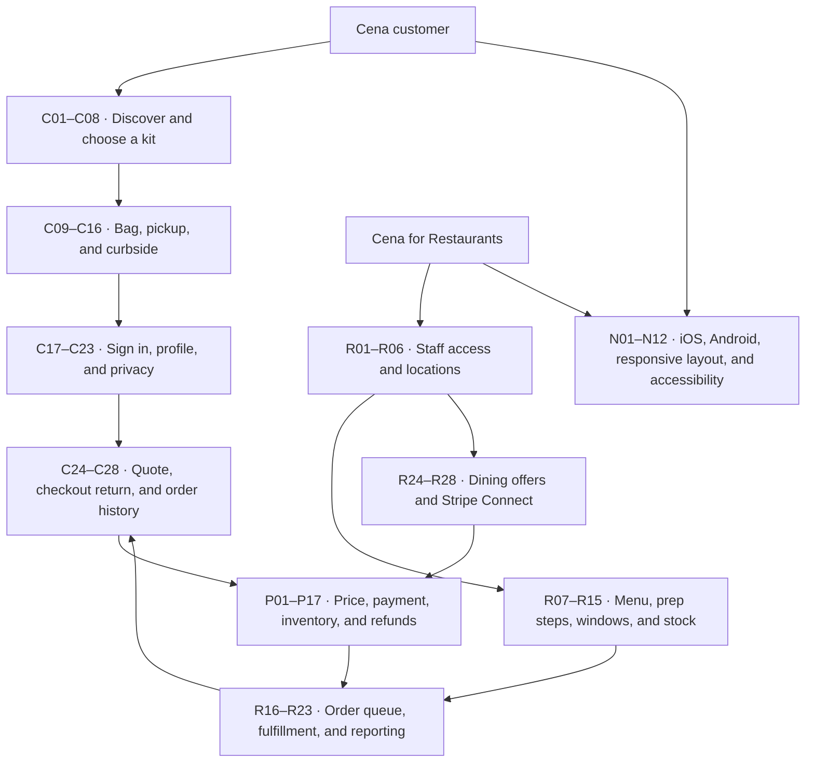

# Cena test coverage

The graph follows the two apps from setup to pickup and refund. Node labels identify the scenarios, expected results, and verification evidence in the tables below. Run the checks locally.

| Status | Evidence required |
| --- | --- |
| Pass | The current checkout, app, API, or database behavior was exercised at the layer listed. |
| Partial | The cited result covers some branches or fewer platforms than the scenario requires. |
| Open | The test or environment is still missing, or an observed failure needs a fix. |

## Customer · discovery, pickup, and account

| ID | Scenario and expected result | Evidence |
| --- | --- | --- |
| C01 | First launch and reload. The shell renders and data either loads or presents a retry. | Partial · iOS launch smoke, Android cold launch, and loaded customer Chromium/WebKit previews. Interrupted network and retry remain open. |
| C02 | Empty, populated, and unavailable Recents. Recent kitchens and meal kits appear first and respect availability. | Partial · discovery SQL tests for sold-out recents, iOS offline empty states, and Chromium section order at 390px. Populated native UI is open. |
| C03 | Nearby kitchens and distance. Ranking changes with location and labels use approximate miles. | Pass · SQL distance, range, and filter coverage. Native visual check open. |
| C04 | Address entry, denied device location, permission revocation, and manual fallback. Feed remains usable. | Partial · Playwright opens and dismisses the manual address field. Address search, denial and revocation are open. |
| C05 | Cuisine pages, filters, search, and empty results. Pages append without duplicate restaurants or an unbounded catalog dump. | Pass · paged discovery SQL and anonymous RLS. Visual scrolling and one-handed use remain open. |
| C06 | Menu image and information. Photos keep their crop, and unavailable or unreviewed meal kits cannot be added. | Partial · availability and publication tested in SQL. Native crop, image failure, and slow load are open. |
| C07 | Equipment tags and allergen information. Optional profile selections update equipment warnings. | Open · exercise profile-to-menu behavior on devices. |
| C08 | Live cutoff and expiration. The timer advances, identifies same-day ordering, and closed windows become unavailable. | Partial · SQL cutoff rejection and Chromium shows the correctly labeled timer decrementing by a second. Boundary UI and timezone are open. |
| C09 | First item and repeated add. Pending/confirmed bag changes are visible in the Bag tab. | Partial · native empty bag smoke. Full signed-in journey belongs to browser E2E. |
| C10 | Increase, decrease, remove, and restart. Bag contents and the counter agree after reload. | Partial · Chromium added two kits and retained the bag badge after reload. Removing items and device restart remain open. |
| C11 | Add an item from a second restaurant. The current bag is preserved until the shopper clears it. | Pass · Chromium and WebKit rejected the second kitchen and kept the original item. Native replacement prompts still need replay. |
| C12 | Today unavailable, future day available. The next available day is offered; changing day resets the time. | Partial · Chromium and WebKit verified tomorrow selected with no same-day slots. Calendar tests cover both Los Angeles DST transitions and different service timezones. Day switching on devices remains open. |
| C13 | Same-day order, advance order, sold-out item, or full window. Only viable choices can reach payment. | Pass · SQL rejection and quote lead-time tests. Device presentation is open. |
| C14 | Counter or supported curbside. Vehicle fields appear only for curbside and required details are validated. | Pass · SQL acceptance and curbside rejection. Full app input/keyboard behavior is open. |
| C15 | Back, cancel, refuse a bag replacement, or leave checkout. The bag remains recoverable. | Open · test on WebKit and devices. |
| C16 | Inventory or cutoff changes during payment review. Quote/reservation rejects stale availability; the shopper can choose another time. | Partial · backend rejection tested. Exact recovery UI open. |
| C17 | Guest checkout OTP. Valid code resumes checkout with the same bag and pickup choice. | Pass · Chromium sent and verified a code with local Mailpit and continued to the exact checkout quote. Native payment remains open. |
| C18 | Wrong, expired, reused, or rate-limited OTP. The user can correct their inputs without losing the order. | Open · verify actual auth error, resend behavior, and accessibility. |
| C19 | Returning session. Stored authentication and profile resume across restart and expiry. | Partial · Chromium verified authenticated profile after reload and Android verified local OTP, profile persistence, and an empty field for an unset phone. Earlier iOS offline profile form checks passed. Native refresh and invalidated sessions remain open. |
| C20 | Edit display name, phone, and equipment. Saving persists after reload and ownership is enforced. | Partial · Chromium and WebKit verified account OTP, name and phone save, persistence after reload, and a matching Supabase profile row. Android verified name and phone persistence. Equipment and cross-account browser checks remain open. |
| C21 | Sign out, switch accounts, then return. Another user cannot view or pay the previous account’s pending checkout. | Partial · Go auth, user-scoped RLS, and five local-storage tests cover owner scoping and legacy data removal. Chromium verified checkout continues with the guest bag after OTP. Android emulator rejected another owner’s synthetic bag. Full cross-account checkout replay remains open. |
| C22 | Terms and privacy controls. Checkout opens policies and analytics follows the user’s consent choice. | Partial · SQL verified opt-in enforcement. The iOS source has an independent Profile preference with account-scoped reads and saves. Its device check, finalized policy links, and acceptance across devices remain open. |
| C23 | Privacy request and data minimization. The user can request access/deletion and device location is only used for ranking. | Partial · schema/policy source. Request lifecycle and external fulfillment open. |
| C24 | Review with no code, with a valid code, and with rejected or edited code. Payment matches the approved total. | Pass · Go, SQL and Chromium. A 39-stage Chromium run matched the $33.90 subtotal and $30.51 after a 10% discount. Pausing the promo after the quote returned 422 without creating an order or payment session. Removing the code restored the $33.90 quote. |
| C25 | Redirect, return, app relaunch, and provider cancellation. Bag stays saved while payment is pending. | Partial · Chromium verified bag reload, pending status, canceled session and successful retry with a simulated Stripe return. Prior Android offline deep-link smoke passed. Physical-device return and authenticated relaunch remain open. |
| C26 | Order confirmation. Paid order appears once; failed, pending, and expired payment have truthful UI. | Partial · Chromium verified the paid UI after a signed simulated Stripe webhook and payment status lookup. Go and SQL cover pending and expiry. Real provider and device evidence remain open. |
| C27 | Orders and Recents reflect fulfillment and refunds. Amounts equal the order snapshot. | Partial · Chromium and WebKit reopened Orders after a simulated refund and displayed Refunded with the original $30.51 total and $3.39 savings, without reloading. Native history and Recents after fulfillment remain open. |
| C28 | Poor connection, rapid taps, theme, large text, and narrow checkout. Actions stay reachable and totals cannot change unnoticed. | Open · exact device interaction and stale-total UX. |

## Restaurant · entry, menu, and fulfillment

| ID | Scenario and expected result | Evidence |
| --- | --- | --- |
| R01 | Signed-out screen and incorrect credentials. Shows generic account entry until membership loads. | Partial · iOS and Android offline entry checks. Browser invalid credentials produced an error and retained both fields; its older bundle still showed a location in the header. |
| R02 | Staff, manager, owner, and unauthorized accounts. Only permitted locations and actions are shown. | Partial · promotions/RLS tests. Full cross-role and location-switch UI open. |
| R03 | No membership, inactive location, or stale session. Empty/access state is recoverable. | Open · end-to-end account scenarios. |
| R04 | Switch locations while loading. Earlier responses cannot overwrite a newer location. | Partial · browser app revision guard checked in source; timed interaction open. |
| R05 | Sign out, relaunch, and resume an expired session. Private ops are cleared or restored only for the right account. | Open · authenticated device test. |
| R06 | Duplicate taps, permission loss, offline failure, and retry. UI reports the operation’s final result accurately. | Open · test merchant changes and reconnection. |
| R07 | Create or edit a catalog draft with price, photo, allergens, and equipment. Draft stays private until reviewed. | Partial · local SQL verified atomic catalog/draft writes, staff edits, private drafts, and rollback. Android and Chromium verified authenticated draft creation. iOS and photo editing still need replay. |
| R08 | Generate prep steps. Only cooking instructions are regenerated, with restaurant access required. | Pass · prep function tests use a simulated AI response. A real model and device flow are open. |
| R09 | Edit while generating, review, publish, and stale revision. Generation cannot replace a newer draft. | Pass · prep concurrency and SQL publication tests. Android and Chromium published reviewed chef steps in local Supabase. Chromium verified the exact edited text and that staff had no publication control. iOS and live AI remain open. |
| R10 | Pause a published meal. New orders cannot reserve it; prior customer receipts retain their snapshot. | Partial · checkout eligibility. Native menu pause and existing order display open. |
| R11 | Create a pickup window with local timezone, cutoff, length, and capacity. Invalid ranges are rejected. | Pass · direct merchant writes in SQL. Device scheduler, DST, and alternate timezones open. |
| R12 | Stock initial and later quantities. Changes never undercut active holds. | Pass · PGlite integration enforced column grants and quantity constraints. Device editor open. |
| R13 | Delete a held inventory row or booked window. Live order ledger and historical order references survive. | Pass · PGlite suite through migration 00009. |
| R14 | Update an unbooked window, reschedule a paid one, and retry a partially saved window. | Partial · database booked-window protections. App recovery and concurrent edit UX open. |
| R15 | Toggle curbside. Only eligible future restaurant orders offer curbside. | Partial · SQL counter/curbside rules. Device setting-to-customer workflow open. |
| R16 | Paid order enters queue, including advance bookings. Pending checkout does not appear as an order to fulfill. | Pass · Go/SQL persistence and RLS. Native queue interaction open. |
| R17 | Accept, prepare, mark ready, and complete. Only valid transitions appear in customer history. | Partial · PGlite verified full fulfillment. Chromium accepted, prepared and marked a paid test order ready through the merchant UI. Android emulator confirmed Mark picked up advanced a Ready order to `completed` in Supabase. iOS and full browser completion remain open. |
| R18 | Wrong restaurant, duplicate transition, or out-of-sequence update. Status remains consistent. | Partial · SQL status/ownership rules. Multi-device UI behavior open. |
| R19 | New order arrives during a shift. Queue refresh preserves in-progress forms and location. | Open · test scheduled/foreground refresh and accessibility. |
| R20 | Counter order versus curbside. Restaurant sees correct pickup time and vehicle details. | Partial · SQL vehicle persistence. Mobile presentation open. |
| R21 | Refund confirmation, pending refund, retry, and history. Paid orders become canceled only after a verified refund. | Partial · Chromium verified direct cancellation was rejected, dismissing the refund prompt made no provider call, and confirming it refunded the paid test order. SQL covers pending, staff rejection and retries. Native and real Stripe verification remain open. |
| R22 | Order totals and sales summaries use paid snapshots including discounts and fees. | Partial · price persistence tests. Customer receipt and merchant analytics visual reconciliation open. |
| R23 | Analytics, privacy opt-out, and operator visibility. Behavioral events respect consent and reports are role-scoped. | Partial · consent test. Operator analytics and client telemetry exercise open. |
| R24 | Create, schedule, pause, and enable promo. New codes default paused and ownership is enforced. | Partial · SQL role, scheduling and cap tests passed. The restaurant browser replay saved the paused promo and enabled it through the UI. Native forms remain open. |
| R25 | Readiness before/after onboarding. UI updates using authoritative account charges/payouts state. | Partial · the browser replay verified initial `not_connected`, completed simulated Connect onboarding, and displayed the $1.75 fee. Genuine Stripe onboarding remains open. |
| R26 | Resume interrupted onboarding, check mismatched return, and switch location. Return link never sets readiness directly. | Partial · server tests and prior Android sign-in/deep-link smoke. Authenticated device return open. |
| R27 | Fee and amount reconciliation. Charged amount, flat Cena fee, and Stripe account match server snapshot. | Pass · Go/SQL with simulated processor. Real sandbox metadata open. |
| R28 | Capped promotion and simultaneous orders. Reservations consume one use, release it if unpaid, and honor the paid price. | Pass · SQL lifecycle, immutable snapshots, and two concurrent PostgreSQL requests for the final use produced one accepted order. |

## Money · provider and database

| ID | Scenario and expected result | Evidence |
| --- | --- | --- |
| P01 | Missing auth, invalid IDs, bad quantity, or unknown restaurant. API rejects before reserving. | Pass · Go auth, validation, and SQL cases. |
| P02 | No promotion. Item prices and subtotal come from published catalog state. | Pass · Go/SQL tests. |
| P03 | Malformed, case-insensitive, expired, scheduled, paused, or restaurant-mismatched code. Invalid discounts cannot be applied. | Pass · Go/SQL tests. |
| P04 | Percentage rounding, minimum fee, cap, and edit during checkout. Correct snapshot and re-quote on stale price. | Pass · exact cents in SQL/Go. |
| P05 | Unavailable item, stock, capacity, or cutoff. No partial reservation survives rejection. | Pass · SQL stock/capacity/cutoff checks. |
| P06 | Retry and repeated client submit. Same key returns one order and one payment session. | Pass · Go, SQL and Chromium idempotent request replay. Rapid physical double tap remains open. |
| P07 | Session creation fails, expires, or is canceled. Releases stock, slot, and promo hold safely. | Pass · Go and SQL lifecycle tests. |
| P08 | Unpaid orders are invisible to merchants. Signed completion exposes the order only after payment. | Pass · Go, SQL and Chromium. Merchant-scope query excluded the pending browser order before simulated payment. |
| P09 | Missing/wrong signature, wrong account, wrong total, delayed event, and duplicate event. Only matching provider state changes orders. | Partial · Go and SQL cover signature/matching and idempotency. Chromium verified the simulated signed callback returned 200. Real event sequencing remains open. |
| P10 | Resume paid/expired/refunded session. State is checked via API rather than a callback parameter. | Partial · Go and Chromium verified confirmed and expired states with a simulated provider. Refund recovery and native recovery remain open. |
| P11 | Authorized full refund. Stripe result, order status, and inventory reflect verified state. | Partial · Chromium confirmed a full simulated refund after checkout, using the original discounted total. SQL verified owner/staff/outsider access, idempotent settlement, wrong-account webhook lookup, and unit/slot release. Real Stripe refund remains open. |
| P12 | Refund failure, pending result, or repeated request. Order stays consistent and retries remain idempotent. | Partial · local SQL verified pending reuse, incremented attempt after failure, and rejection of stale attempt or mismatched provider ID. Provider-race and native pending/retry are open. |
| P13 | Simultaneous purchase, expiration, and stock edit. Postgres enforces lock order and never oversells. | Partial · two concurrent PostgreSQL requests reused one order for the same idempotency key. Two customers racing for one promo use produced one reservation. Concurrent expiry and stock editing remain open. |
| P14 | Stripe sandbox account live connection, hosted Checkout completion, asynchronous webhook, and refund. | Open · Stripe sign-in reached passkey verification. Real account access, sandbox webhook credentials, and dedicated fixtures remain pending. |
| P15 | Hosted API, database migrations, Auth email delivery, and signed store builds. | Partial · applied migrations `00004`–`00014` to the hosted Cena database and verified Stripe payment tables, atomic pickup creation, checkout and refund price snapshots, and checkout recovery functions. Both existing waitlist entries remained. The hosted prep endpoint returned `204` for preflight and `401` without authentication. Hosted Go API, custom SMTP, an OpenAI API key for drafts, and signed store builds are open. |
| P16 | Production settlement, app fee, and operational recovery. | Open · verify in dedicated sandbox before any live setup. |
| P17 | A recorded checkout expires while the customer and webhook are absent. Confirmed expiry releases held stock and capacity. A confirmed payment settles the order. An uncertain result keeps the hold and retries. | Partial · The running Go worker verified five simulated Stripe expiries and released all five item and pickup holds in local PostgreSQL. Independent connections verified that a second worker skips a locked claim and a stale worker cannot finish it. The hosted database functions are installed. Recovery against genuine Stripe remains open. |

## Device and accessibility

| ID | Scenario and expected result | Evidence |
| --- | --- | --- |
| N01 | SwiftUI customer launch, Home, empty Bag, and Profile. | Partial · prior simulator checks passed. Latest source needs local macOS rebuild. |
| N02 | SwiftUI restaurant launch and staff entry; authenticated settings, promotions, refund, and inventory. | Partial · prior simulator sign-in passed. Latest build and authenticated operations are open. |
| N03 | Android customer debug and release builds, launch, Home and bag. | Partial · both variants built locally. API 36 emulator verified direct discovery on launch, search, the Recents and Near you rail order, local OTP, profile and bag ownership, and same-day/next-day labels. A fresh Go API accepted a $14.50 no-code checkout, the simulated provider callback returned 200, and the app confirmed the same paid total in Orders. Actual Stripe and physical device checkout remain open. |
| N04 | Android restaurant debug and release builds, launch, login, return link. | Partial · both variants built locally. API 36 emulator signed into a disposable merchant account and verified curbside, reviewed kit publication, and marking a Ready pickup complete. Insights showed the correct 30- and 90-day totals and preserved the selected period while resizing between 720×1280 and 1080×2400. An earlier run checked the offline return link. Genuine Stripe onboarding and refund remain open. |
| N05 | Browser previews at compact phone, iPhone, tablet and desktop. No unintended horizontal overflow. | Partial · Chromium and WebKit checked entry screens at widths 320, 390, and 834. Chromium also verified discovery, pickup and checkout at 320×568, 375×667 and 844×390. The live waitlist fields match at 60px tall, and the restaurant promo Save action remains reachable at 390×844. |
| N06 | Motion during carousel, modal, tab changes, and payment confirmation. Reduced Motion disables nonessential transitions. | Partial · Chromium sampled intermediate customer opacity and translation and verified the reduced-motion setting skipped them. Native settings and physical device frame timing remain open. |
| N07 | Screen reader labels and focus order through checkout and merchant forms. Browser supports keyboard-only interaction. | Partial · Chromium verified selected pickup radio state after the ARIA fix. VoiceOver and TalkBack full journeys are open. |
| N08 | Dynamic type, zoom, large display size, iPad, landscape, foldable/narrow screen, and safe areas. | Open · device matrix. |
| N09 | Contrast and visible states in the warm theme, bright light, and OS dark mode. | Partial · text pair contrast checked; interactive screen states remain open. |
| N10 | Offline, slow connection, interruption, relaunch, background/foreground, stale data, and connection change. | Partial · Android customer and restaurant emulators renewed short-lived sessions against a loopback Auth fixture and resumed authenticated reads after rotation. Broader network disruption testing is open. |
| N11 | Physical-phone full purchase and merchant pickup using reachable HTTPS services. | Open · device and sandbox environment. |
| N12 | Installed links return to correct app; missing app fallback is usable. | Partial · website route buttons, Expo return-path mapping, and Android guest return checked. Paid return and iOS physical link are open. |

## Replay the evidence

The hosted migrations were applied through the Supabase SQL Editor in transactions. Before a future CLI migration push, compare the hosted schema with the repository and reconcile the migration history so the CLI does not replay those files.

| Check | Run locally |
| --- | --- |
| TypeScript for both app previews and the website | `pnpm typecheck` |
| Supabase behavior and prep request handling | `pnpm test` |
| Go routes and simulated Stripe responses | `go test ./...` from `backend/go` |
| App journeys with disposable local data and simulated Stripe | `pnpm test:e2e`, after following the [browser setup](../scripts/e2e/README.md) |
| Customer discovery layout, timer, and pickup area | `node scripts/e2e/customer-interactions.mjs` against a loopback customer preview with Supabase and eligible seeded pickups. |
| Small-screen checkout and entrance motion | `node scripts/e2e/customer-responsive-motion.mjs` against a loopback customer preview with Supabase and eligible seeded pickups. |
| Android build and emulator | Follow the [Android build steps](../native/android/README.md), then run `bash scripts/android-smoke.sh` from the repo root with an Android emulator connected. |
| iPhone simulator | Follow the [XcodeGen and XCTest commands](../native/ios/README.md#build-on-macos) on a Mac. |
| Real Stripe connection and checkout expiry | Follow the [opt-in sandbox procedure](../backend/go/README.md) with a dedicated test account and test Supabase project. This check creates and expires an unpaid session. |
